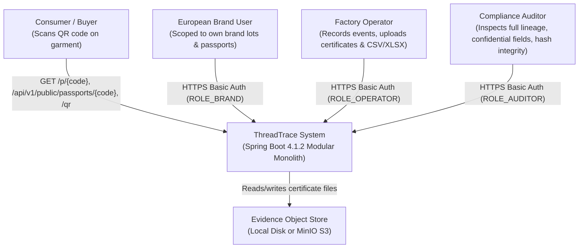
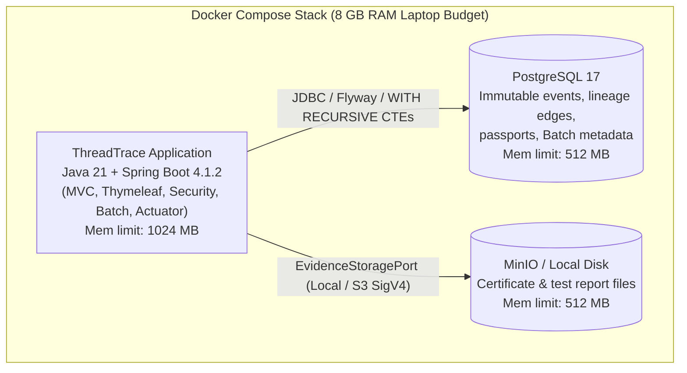
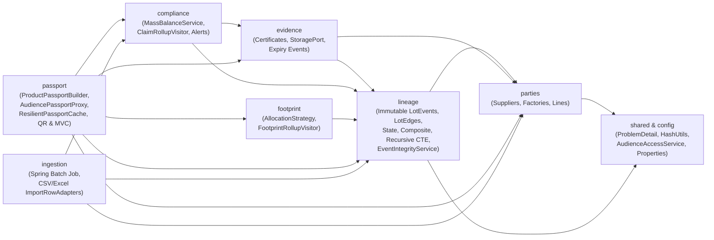

# ThreadTrace Architecture Documentation (C7)

## 1. C4 Context Diagram

## 2. C4 Container Diagram

## 3. C4 Component Diagram (Modular Monolith Boundaries Enforced by ArchUnit)

## 4. Mini-ATAM Utility Tree, Sensitivity Points & Trade-offs

| Quality Attribute | Scenario | Target Measure | Architectural Tactic |
|---|---|---|---|
| **Trace Speed (QA1)** | Backward/forward trace across 6 process levels on 200k lots / 2M events | <= 2.0 s | Indexed `lot_edges(parent_lot_id, child_lot_id)` & `(child_lot_id, parent_lot_id)` + single SQL `WITH RECURSIVE` CTE |
| **Claim Correctness (QA2)** | Seeded dataset with over-claimed recycled content, expired cert, excess cutting loss, orphan lot | 100% detected, 0 unsupported claims | `MassBalanceService` + `ClaimRollupVisitor` + `@TransactionalEventListener` auto-recalculation on expiry |
| **Confidentiality (QA3)** | Scan of public endpoints & cross-brand API calls | 0 confidential fields leaked, 100% cross-brand refused | Separate audience DTOs + `AudiencePassportProxy` + `AudienceAccessService` |
| **Passport Delivery (QA4)** | Public passport load on mobile / during DB outage | < 2.0 s & served from cache when DB down | Lightweight Thymeleaf HTML (no external CDNs), HTTP `Cache-Control` + `ETag`, `ResilientPassportCache` fallback on `DataAccessException` |
| **Adaptability (QA5)** | Add new certificate type, process step, emission factor, or passport field | Config-only change (0 code edits) | Validated `@ConfigurationProperties` (`ThreadTraceProperties`) + extensible `additionalFields` map in `ProductPassportBuilder` |
| **Auditability & Integrity (FR10)** | Tampering with stored lot event row in DB | 100% detected on verification | Append-only `@Immutable` `LotEvent` + per-lot SHA-256 hash chain verified by `EventIntegrityService` |

### Sensitivity & Trade-off Points
1. **Sensitivity Point — `lot_edges` Indexing & CTE Depth**: Trace latency is directly sensitive to composite B-tree index selectivity on `lot_edges` and batch-loading `Lot`/`LotEvent` rows rather than N+1 JPA lazy loading.
2. **Trade-off — Modular Monolith CQRS Read Models vs. Live Graph Joins**: Materializing versioned JSON in `product_passports` duplicates lineage/footprint summaries, trading minor storage overhead and event-driven recalculation complexity for sub-50ms public reads, ETag stability, and DB-outage cache resilience.
3. **Trade-off — PostgreSQL Recursive CTE vs. Neo4j**: Choosing PostgreSQL avoids operating a second database container on an 8 GB RAM laptop (C1) while keeping transactional ACID consistency between immutable events, Spring Batch metadata, and lineage edges.
