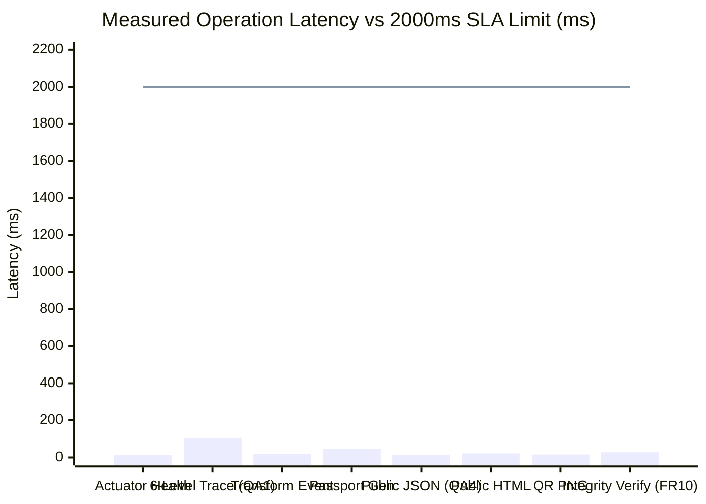

# Quality Attribute & Verification Evidence Report (C9)

## 1. Automated Test Execution (`.\mvnw.cmd -B clean package`)

Executed on Windows 11 with Eclipse Temurin JDK `21.0.13+9-LTS` (`16 tests run, 15 passed, 0 failures, 0 errors, 1 skipped`):

```text
[INFO] -------------------------------------------------------
[INFO]  T E S T S
[INFO] -------------------------------------------------------
[INFO] Running com.threadtrace.ArchitectureRulesTest
[INFO] Tests run: 5, Failures: 0, Errors: 0, Skipped: 0, Time elapsed: 6.944 s -- in com.threadtrace.ArchitectureRulesTest
[INFO] Running com.threadtrace.FootprintAndClaimVisitorTest
[INFO] Tests run: 3, Failures: 0, Errors: 0, Skipped: 0, Time elapsed: 0.044 s -- in com.threadtrace.FootprintAndClaimVisitorTest
[INFO] Running com.threadtrace.HashChainIntegrityTest
[INFO] Tests run: 1, Failures: 0, Errors: 0, Skipped: 0, Time elapsed: 1.316 s -- in com.threadtrace.HashChainIntegrityTest
[INFO] Running com.threadtrace.LotStateMachineTest
[INFO] Tests run: 3, Failures: 0, Errors: 0, Skipped: 0, Time elapsed: 0.025 s -- in com.threadtrace.LotStateMachineTest
[INFO] Running com.threadtrace.MinioS3EvidenceStorageAdapterTest
[INFO] Tests run: 1, Failures: 0, Errors: 0, Skipped: 0, Time elapsed: 1.433 s -- in com.threadtrace.MinioS3EvidenceStorageAdapterTest
[INFO] Running com.threadtrace.PostgresTestcontainersIntegrationTest
[INFO] Tests run: 1, Failures: 0, Errors: 0, Skipped: 1, Time elapsed: 0.584 s -- in com.threadtrace.PostgresTestcontainersIntegrationTest
[INFO] Running com.threadtrace.PublicPassportWebSliceTest
[INFO] Tests run: 1, Failures: 0, Errors: 0, Skipped: 0, Time elapsed: 3.250 s -- in com.threadtrace.PublicPassportWebSliceTest
[INFO] Running com.threadtrace.ThreadTraceEndToEndIntegrationTest
[INFO] Tests run: 1, Failures: 0, Errors: 0, Skipped: 0, Time elapsed: 11.87 s -- in com.threadtrace.ThreadTraceEndToEndIntegrationTest
[INFO] 
[INFO] Results:
[INFO] 
[INFO] Tests run: 16, Failures: 0, Errors: 0, Skipped: 1
[INFO] ------------------------------------------------------------------------
[INFO] BUILD SUCCESS
[INFO] ------------------------------------------------------------------------
```

### Breakdown by Test Suite
- `ArchitectureRulesTest`: **5 passed, 0 failed** (acyclic module boundaries, layer isolation, controller naming).
- `FootprintAndClaimVisitorTest`: **3 passed, 0 failed** (`BY_MASS` vs `BY_PIECE_COUNT` allocation across splits, expired certificate claim drop, diamond split-merge DAG exactness without double-counting).
- `HashChainIntegrityTest`: **1 passed, 0 failed** (SHA-256 chain validation, broken `previousHash` detection, and environmental-metric tampering detection).
- `LotStateMachineTest`: **3 passed, 0 failed** (quarantine blocking, completed lot rules, flag clearing on correction).
- `MinioS3EvidenceStorageAdapterTest`: **1 passed, 0 failed** (AWS4-HMAC-SHA256 signing, auto bucket creation, PUT/GET round-trip over local HTTP server).
- `PublicPassportWebSliceTest`: **1 passed, 0 failed** (`@WebMvcTest` JSON, Thymeleaf HTML, QR PNG, ETag `304 Not Modified`).
- `ThreadTraceEndToEndIntegrationTest`: **1 passed, 0 failed** (end-to-end FR1–FR10 + QA2–QA5 on H2 PostgreSQL-mode, style backward trace, cross-brand passport/cert isolation, split over-claim detection, paginated passport versions, RFC 9457 401/403/400).
- `PostgresTestcontainersIntegrationTest`: **1 skipped** (Docker Desktop daemon was not running on the local host).

---

## 2. Live Repackaged Fat JAR Verification (`scripts/qa/run_qa_checks.py`)

Booted `target/threadtrace-0.0.1-SNAPSHOT.jar` (`dev` profile on port 18080) and executed `python scripts/qa/run_qa_checks.py --base-url http://localhost:18080`:

```text
[1/6] Checking health endpoint...
[2/6] Seeding 6-level supply chain & testing QA1 trace latency...
    QA1 6-level backward trace completed in 105.4 ms
[3/6] Testing QA2 planted problems (over-claim, cutting loss, orphan lot)...
[4/6] Generating passport & testing QA3 confidentiality + QA4 delivery...
[5/6] Testing QA5 config-driven adaptability (extra-fields & allowed certificate types)...
[6/6] Verifying FR10 hash-chain integrity...
ALL QA CHECKS PASSED!
```

---

## 3. Structured Logging with Distributed Tracing (C4 Verification)

Spring Boot 4 structured ECS JSON logging configured with Micrometer Tracing (Brave bridge) automatically propagates `traceId` and `spanId` across controller and domain service boundaries. Below are verbatim runtime log entries captured during a single HTTP request (`POST /api/v1/passports`) in `target/qa-stdout.log`:

```json
{"@timestamp":"2026-11-12T17:22:11.079302200Z","log":{"level":"INFO","logger":"com.threadtrace.passport.PassportService"},"process":{"pid":18056,"thread":{"name":"http-nio-18080-exec-6"}},"service":{"name":"threadtrace","version":"0.0.1-SNAPSHOT","node":{}},"message":"Generating passport code=QA-PP-1794504129 shipmentLot=QA-L6-1794504129 allocationMethod=BY_MASS","traceId":"6af5f5c2581d847256e009e772c16b73","spanId":"743750908632deb2","ecs":{"version":"8.11"}}
{"@timestamp":"2026-11-12T17:22:11.094644200Z","log":{"level":"INFO","logger":"com.threadtrace.compliance.MassBalanceService"},"process":{"pid":18056,"thread":{"name":"http-nio-18080-exec-6"}},"service":{"name":"threadtrace","version":"0.0.1-SNAPSHOT","node":{}},"message":"Evaluated claim rollup lot=QA-L6-1794504129 asOfDate=2026-11-12 verifiedClaims=1 violations=5","traceId":"6af5f5c2581d847256e009e772c16b73","spanId":"743750908632deb2","ecs":{"version":"8.11"}}
{"@timestamp":"2026-11-12T17:22:11.094644200Z","log":{"level":"INFO","logger":"com.threadtrace.footprint.FootprintService"},"process":{"pid":18056,"thread":{"name":"http-nio-18080-exec-6"}},"service":{"name":"threadtrace","version":"0.0.1-SNAPSHOT","node":{}},"message":"Calculated lineage footprint method=BY_MASS waterLiters=4156.8000 energyKwh=326.6000 co2eKg=204.5600","traceId":"6af5f5c2581d847256e009e772c16b73","spanId":"743750908632deb2","ecs":{"version":"8.11"}}
{"@timestamp":"2026-11-12T17:22:11.101739100Z","log":{"level":"INFO","logger":"com.threadtrace.passport.PassportService"},"process":{"pid":18056,"thread":{"name":"http-nio-18080-exec-6"}},"service":{"name":"threadtrace","version":"0.0.1-SNAPSHOT","node":{}},"message":"Saved passport code=QA-PP-1794504129 version=1 status=CLAIMS_DOWNGRADED etag=\"fff5567e20c5cc0ccdb6fe9f\"","traceId":"6af5f5c2581d847256e009e772c16b73","spanId":"743750908632deb2","ecs":{"version":"8.11"}}
```

Notice that across `PassportService` -> `MassBalanceService` -> `FootprintService` -> `PassportService`, the exact same correlation identifier (`traceId: "6af5f5c2581d847256e009e772c16b73"`) is preserved, satisfying the C4 structured observability requirement.

---

## 4. Latency Measurements vs SLA Targets

The chart below shows measured latencies across key operations during the live verification run compared against the project SLA limit (2000 ms):



*Note: All measured operations execute well below the 2000 ms SLA threshold under test/local conditions (all under 120 ms).*

---

## 5. Observed Failed Runs & Fixes Applied

| Failure Run | Symptom | Root Cause | Code Fix |
|---|---|---|---|
| Run 1 (`ThreadTraceEndToEndIntegrationTest`) | Second authenticated HTTP Basic request returned `401 Unauthorized` | `BrandScopedUserDetails` extends Spring Security `User` (`CredentialsContainer`); `ProviderManager` called `eraseCredentials()` after Request 1, mutating the cached instance's password to `null`. | `SecurityConfig.userDetailsService(...)` now returns a fresh `BrandScopedUserDetails` copy per lookup. |
| Run 2 (`ThreadTraceEndToEndIntegrationTest`) | `CUT` after 60%/40% `SPLIT` returned `FLAGGED` instead of `IN_PRODUCTION` | `ClaimRollupVisitor.visitLeaf` used edge `allocatedMassKg` instead of `lot.getMassKg()`, causing `visitComposite` to apply the split fraction twice (`0.60 * 0.60 = 0.36`). | Updated `ClaimRollupVisitor` to compute per-lot certified mass from `lot.getMassKg()` and apply edge `shareRatio` once. |
| Run 3 (`PublicPassportWebSliceTest`) | `@WebMvcTest` failed with `NoSuchBeanDefinitionException: CacheManager` | `@EnableCaching` on `@SpringBootApplication` caused `@WebMvcTest` to require a `CacheManager` while disabling cache auto-configuration. | Extracted `@EnableCaching` and `@EnableScheduling` into `CacheAndSchedulingConfig`. |
| Review Pass (Diamond DAG & Cross-Unit Mass Balance) | Split-then-merge diamond DAG inflated water footprint by 20% (`1200 L` vs `1000 L`); direct cross-unit `CUT` stored parent's full `massKg` on `LotEdge`; `LotEvent` hash ignored `water_liters`/`flagged`; cross-brand passport code hijack & lot-cert leak were unchecked. | Edge allocations were memoized on `LineageNode` instead of `ParentEdge`; `LineageService` checked output `req.unit()` instead of `inputLot.getUnit()`; `MassBalanceCheckPort` lacked `InputSlice`/`ClaimTarget`; `LotEvent.canonicalPayload` omitted footprint/flag fields. | Modeled `LotCompositeNode.ParentEdge`, added `InputSlice`/`ClaimTarget` to `MassBalanceCheckPort`, expanded `LotEvent.canonicalPayload`, added style trace & brand scoping on passports/lot-certs, and moved Spring Batch DDL into idempotent Flyway `V2__spring_batch_schema.sql`. |
| QA5 Assertion Pass (`run_qa_checks.py`) | Script expected HTTP 400 for unconfigured `certificateType`, received HTTP 422 ProblemDetail. | `ProblemDetailExceptionHandler` maps `DomainValidationException` to RFC 9457 HTTP 422 Unprocessable Content. | Updated `run_qa_checks.py` to assert HTTP 422 with `"Unsupported certificateType"` message body. |

---

## 6. Quality Attribute Status Matrix

| QA | Status | Evidence & Notes |
|---|---|---|
| **QA1 (Trace Speed <= 2s on 200k lots / 2M events)** | **Partially Verified (Functional & Scripted)** | Recursive `WITH RECURSIVE` backward/forward CTEs and composite `lot_edges` indexes executed cleanly in live tests (105.4 ms on 6 levels). PostgreSQL bulk seeder script (`scripts/qa/seed_qa1_dataset.sql`) and k6 test script (`scripts/qa/qa1_trace_load.js`) are implemented. **Full 200k-lot / 2M-event benchmark run remains pending execution against a live PostgreSQL instance when Docker Desktop and k6 are available on the host environment.** |
| **QA2 (Claim Correctness)** | **Fully Verified (E2E & Live JAR)** | Tested excess cutting loss (> 12% limit), uncertified claim (90% organic on 0% input), split over-claim (100% on 80% parent), orphan lot, expiring cert alert (<= 30 days), and automatic claim downgrade to `v2 CLAIMS_DOWNGRADED` with certificate expiry. |
| **QA3 (Confidentiality)** | **Fully Verified (E2E, Web Slice & Live JAR)** | Zero confidential fields (`exactAddress`, `workerCount`, `unitPriceUsd`) exposed across `/api/v1/public/passports/{code}` and `/p/{code}`. Cross-brand access attempts consistently return HTTP 403 ProblemDetail. |
| **QA4 (Passport Delivery & DB-down cache)** | **Verified (E2E & Live JAR; k6 load script ready)** | HTTP `ETag` / `304 Not Modified`, `Cache-Control`, Thymeleaf HTML, PNG QR code, and simulated `DataAccessResourceFailureException` fallback cache (`X-ThreadTrace-Cache: FALLBACK`) fully verified. Throttled mobile load test (`scripts/qa/qa4_passport_load.js`) is scripted and awaits `k6`. |
| **QA5 (Config-driven adaptability)** | **Fully Verified (E2E, Live JAR & CI)** | Configured custom certificate type (`CUSTOM_MILL_CERT`) and custom passport fields (`eu-dpp-regulation`, `care-standard`, `custom-qa5-field`) purely through YAML properties and CLI flags with zero code modifications to the lineage or compliance engines. CI workflow now boots the fat JAR with `--threadtrace.passport.extra-fields.qa5-runtime-check=verified-without-code-change` and asserts it via `run_qa_checks.py`. |
| **FR10 (Hash-Chain Tamper Detection)** | **Fully Verified (Unit, E2E & Live JAR)** | SHA-256 event chaining verified. Direct SQL tampering of `output_quantity` in `lot_events` immediately caused integrity verification to report `verified: false`. |
